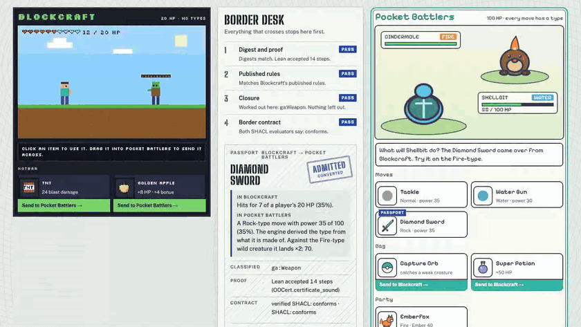

# Asset Passport

[](https://fabio-rovai.github.io/asset-passport/)
[](https://github.com/fabio-rovai/asset-passport/actions/workflows/tests.yml)
[](LICENSE)

[](https://fabio-rovai.github.io/asset-passport/)

<sub>Click the recording to play it at [fabio-rovai.github.io/asset-passport](https://fabio-rovai.github.io/asset-passport/). Drag an item from one game into the other. Every verdict is the engine's own output. Full quality: [docs/assets/demo.mp4](docs/assets/demo.mp4).</sub>

Two small browser games with a border between them. Blockcraft is a block-building game: a player has 20 HP and there are no elemental types. Pocket Battlers is a creature battler: a creature has 100 HP and every move has a type. Drag a thing from one game into the other. [Open Ontologies](https://github.com/fabio-rovai/open-ontologies) works out what it is, the receiving game converts it under a rule it declared, a Lean checker on the receiving side re-checks the proof, and the receiving game's own contract decides. Then the thing shows what it does.

A Diamond Sword deals 7 of a player's 20 HP in Blockcraft (35%). In Pocket Battlers it becomes a move with power 35 of 100, and its type is Rock. Nobody typed that type. Blockcraft's profile says "anything made of diamond is Rock-typed", and the engine derives the rest, so the sword lands super effective on a Fire creature. TNT is refused, because 24 of 20 HP would knock out a full-health creature in one turn. A Capture Orb is refused by Blockcraft, where nothing can own a mob.

The point is the AI game-merge trend of autumn 2026, where people had Claude rewrite two games until they ran together. Those merges have no step that checks what a sword should become on the other side. This repository is that step, on two games small enough to read in an afternoon. Both games, their creatures and their art are original.

## What happens at the border

An item leaves its game as a passport: the item's graph, the game's published profile, and a derivation certificate, packed by `onto_pack`. The receiving game runs four gates in order, and the first one that fails decides.

1. **Digest and proof.** `onto_unpack` checks both SHA-256 digests and runs this machine's `oo-cert` over the certificate.
2. **Published rules.** The rules inside the passport must equal the source game's published profile. A proof over doctored rules still checks, so this gate compares them line by line.
3. **Closure.** The receiving game reasons over the item itself and refuses a passport that left a conclusion out. A proof can show that what it says follows; it cannot show that the sender said everything that follows.
4. **Border contract.** The receiving game's SHACL shapes run on two evaluators, the SPARQL-compiling one and the verified `oo-shacl`. The item crosses only when both agree. Warnings in a separate loss contract name what the item loses on the way in.

## What the engine said

The table is written by `scripts/build_site.py` from the engine's own output. Do not edit it by hand.

<!-- verdicts:start -->
| Item | Into | Verdict | Converted values | Proof steps (Lean) |
|---|---|---|---|---|
| Blockcraft `diamond_sword` | Pocket Battlers | converted | typeInTarget ga:Rock, damageInTarget 35 | 14 |
| Blockcraft `tnt` | Pocket Battlers | refused | damageInTarget 120 | 9 |
| Blockcraft `golden_apple` | Pocket Battlers | converted_with_loss | healInTarget 40 | 10 |
| Pocket Battlers `emberfox` | Blockcraft | converted_with_loss | hitPointsInTarget 20, damageInTarget 8 | 14 |
| Pocket Battlers `capture_orb` | Blockcraft | refused | none | 8 |
| Pocket Battlers `super_potion` | Blockcraft | converted | healInTarget 10 | 9 |

| Forgery on the Capture Orb | Result | Stopped at |
|---|---|---|
| Edit the passport | refused | unpack |
| Edit it, then fix the digests | refused | closure |
| Forge the proof | refused | unpack |
| Bring your own rules | refused | rules |
| Lie about the item | converted | gets through |
<!-- verdicts:end -->

## Where the guarantee ends

A forger who lies about the thing itself gets through. Export the Capture Orb with its `kind` field set to `SuperPotion`, under Pocket Battlers' real profile, and every step after that is honest, so the orb crosses as a potion. A passport proves the paperwork follows from the published rules. It cannot prove what the sender says the thing is. That needs the source game to sign its exports, which this demo does not do yet. `tests/test_verdicts.py::test_a_lie_about_the_item_gets_through` pins the gap, so the page cannot quietly stop saying so.

## Run it

You need Python 3.10+ and an Open Ontologies build. The scripts look for `../open-ontologies/target/release/open-ontologies` and its Lean checkers in `../open-ontologies/lean/.lake/build/bin/`. Set `OO_BIN`, `OO_CERT` and `OO_SHACL` to point elsewhere.

```sh
python3 -m pytest -q tests        # every verdict, gate and forgery, against the real engine
python3 scripts/build_site.py     # judge every item and forgery, write site/data/verdicts.json
python3 local.py                  # http://localhost:8765: drag items between the games, and use the live forge
```

Passports that carry a certificate need an engine with open-ontologies #266, which landed after v2.0.1. The live forge uses the "direct" lane, which runs on the v2.0.1 release: one store, `oo-cert` run by `passport/judge.py`, the same border.

## Deploy

The page is static, and GitHub Pages serves `site/` on every push that changes it (`.github/workflows/pages.yml`). Pages has no engine server of its own. The copy at fabio-rovai.github.io sends its live forge to the engine API named by `VERCEL_API` in `site/config.js`, and that API lets only this origin (and the local server) read its answers (`passport/cors.py`). While `VERCEL_API` is empty, and on any other static host, the forge is off and says so.

For the engine API, `vercel.json` serves `site/` and runs `api/index.py`. `build.sh` downloads the pinned release (`OO_ENGINE_TAG`, default `v2.0.1`) with `oo-cert` and `oo-shacl`. Each file must match both the release's `SHASUMS.txt` and the checksum written into `build.sh`, and a tag with no checksums in `build.sh` is refused. `.vercelignore` keeps tests, docs and any local `api/_bin` out of the upload. The API has no login and no rate limit of its own: anyone can call it, and each call runs the engine once.

## Layout

| Path | What it is |
|---|---|
| `ontology/ga-core.ttl` | The Game Asset hub every game maps into |
| `games/*/profile.ttl` | Each game's health scale and the mapping of its own words (kinds, materials, type names) into the hub |
| `games/*/items.json`, `mapping.json` | Each game's own item data, and how `onto_ingest` reads it |
| `rules/convert.rq` | The declared conversion policy, as a SPARQL CONSTRUCT |
| `contracts/*-border.shacl.ttl` | What each game refuses |
| `contracts/*-loss.shacl.ttl` | What a thing loses on the way in, as warnings |
| `passport/` | The MCP client, the four gates, the forger, the live API |
| `site/` | The page and both games, plain canvas, no framework |

Every arithmetic chain in `rules/convert.rq` is fully parenthesised on purpose. The comment at the top of that file explains why.

## Contributing and licence

A third game, a new refusal, a new forgery, or signed exports: see [CONTRIBUTING.md](CONTRIBUTING.md). Every
number on the page has to come from the engine, and every new check lands with a test where it fails.

MIT, like [Open Ontologies](https://github.com/fabio-rovai/open-ontologies). Both games, their creatures and
their art are original to this project.
